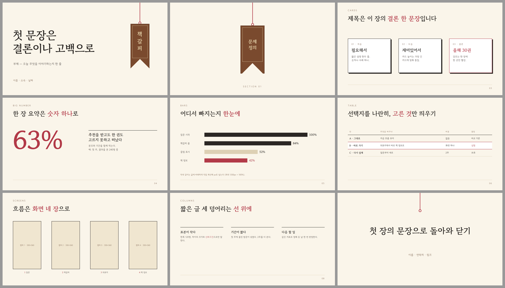

# canva-deck — 이야기부터 쓰고, HTML로 그리고, Canva에서 마무리하는 발표 자료 스킬

Claude가 발표 자료를 이렇게 만들게 하는 스킬입니다.

1. **이야기** — 장마다 제목을 "그 장의 결론 한 문장"으로 쓴 스토리보드
2. **장표** — 크림 종이 + 책갈피 테마의 HTML 장표 (1920×1080, 토큰만 바꾸면 다른 테마)
3. **점검** — 장마다 스크린샷을 찍어 겹침·줄바꿈을 미리 고침
4. **Canva로** — 공개 주소에 올려 Canva 커넥터로 **편집 가능한 디자인**으로 가져오고 합침
5. **마무리** — 캡처 채우기·문구·발표자 노트, 사용자가 확인한 뒤에만 저장



실제 30장짜리 발표를 이 방식으로 만들며 겪은 문제 25가지와 해결 규칙이 `skills/canva-deck/references/pitfalls.md`에 있습니다
(예: `box-shadow`·``는 Canva로 넘어오지 않음, PDF로 올리면 한글이 조각남, 병합은 한 번에 작업 하나).

## 설치

### Claude Code (플러그인으로 — 추천)

Claude Code에서:

```
/plugin marketplace add JunheePark0224/canva-deck-skill
/plugin install canva-deck@canva-deck-skill
```

업데이트는 `/plugin marketplace update canva-deck-skill`.

### Claude Code (폴더 복사)

```bash
git clone https://github.com/JunheePark0224/canva-deck-skill.git
cp -r canva-deck-skill/skills/canva-deck ~/.claude/skills/
```

### Claude.ai (웹·앱)

`skills/canva-deck` 폴더를 zip으로 묶어 **설정 → 기능(Capabilities) → 스킬**에서 올립니다.

## 쓰는 법

설치 뒤 그냥 말하면 됩니다. 예: "이 보고서로 10분짜리 발표 자료 만들어줘, Canva로", "포트폴리오 발표 장표 짜줘".

## 필요한 것

| | 왜 |
|---|---|
| **Canva 커넥터** (claude.ai 또는 Claude Code에 연결) | HTML을 편집 가능한 Canva 디자인으로 가져오기. 없으면 3단계(HTML + 스크린샷)까지만 |
| **공개 주소에 올릴 곳** (Vercel·Netlify·GitHub Pages 등) | Canva는 공개 https 주소에서만 가져옴. 장표는 `noindex`로 올리고 끝나면 내려도 됨 |
| Node + Playwright (선택) | `scripts/shoot.mjs` 장표 스크린샷 |
| Python + Pillow (선택) | `scripts/fit_image.py` 캡처를 액자 비율로 자르기 |

## 구성

```
.claude-plugin/          플러그인·마켓플레이스 정보
skills/canva-deck/
  SKILL.md               흐름과 규칙 (Claude가 읽음)
  assets/
    starter-deck.html    레이아웃 9종 (표지·구분·카드·큰 숫자·막대·표·화면·세 단·마무리)
    storyboard-template.md
    robots.txt
  references/
    pitfalls.md          겪은 문제 25가지와 규칙
    canva-steps.md       올리기 → 가져오기 → 합치기 → 고치기 → 저장
    themes.md            토큰으로 테마 바꾸기 (기본 + 2종)
  scripts/
    shoot.mjs            장마다 스크린샷
    fit_image.py         캡처를 액자 비율로 자르기
```

글꼴 고운바탕·고운돋움은 SIL Open Font License(무료)로 Google Fonts에서 불러옵니다.

---

## English

A Claude skill for story-first decks. It writes a storyboard whose slide titles are one-sentence conclusions and hand-builds
HTML slides (a cream-paper + bookmark theme, swappable by tokens). It screenshots every slide, hosts the pages and imports
them into Canva as an editable design through the Canva connector. Then it places screenshots and finishes the wording,
saving only after the user approves. Install it with `/plugin marketplace add JunheePark0224/canva-deck-skill`, then
`/plugin install canva-deck@canva-deck-skill`. Requires the Canva connector and a public static host.

MIT License.
